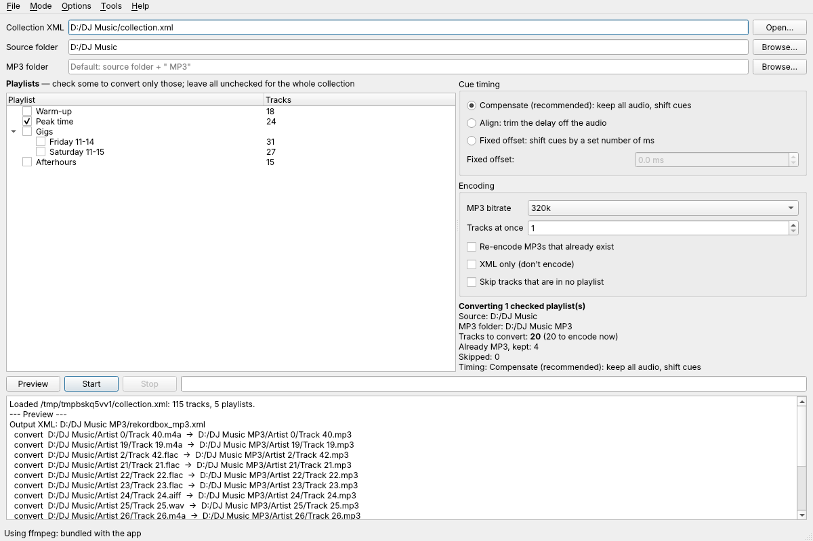

# CueCarry

**CueCarry** is a Windows app for rekordbox users. It makes an MP3 copy of a FLAC, WAV, AIFF or ALAC rekordbox library. Playlists, hot cues, loops, beatgrids, ratings and tags carry over to the copy.

Your original files and your rekordbox collection are never changed. The app writes MP3s into a separate folder, plus a new rekordbox XML file that you import.



## Start here

**Open [`index.html`](index.html)** (double-click it, or run `start index.html`). It links everything: the app, the build and the tests.

- **To use the app:** see [Using the app](#using-the-app).
- **To build the app:** see [Building the Windows app](#building-the-windows-app).
- **To read the code:** see [How the code is organized](#how-the-code-is-organized).

---

## What carries over

| Item | Carried over | Notes |
|---|---|---|
| Playlists and playlist folders | ✅ | Copied into a folder named **MP3**, each renamed `<name> (MP3)` |
| Hot cues A–H, names, colors | ✅ | Shifted to match the MP3 timing (see [Cue timing](#cue-timing)) |
| Saved loops, memory cues | ✅ | Shifted the same way. Memory cue colors are not in rekordbox's XML, so they are lost |
| Beatgrid, BPM, key | ✅ | Grid shifted the same way |
| Rating, play count, date added, color, comments | ✅ | |
| File tags and cover art | ✅ | rekordbox's tag values win over the file's, so edits made in rekordbox carry over |
| MyTags | ❌ | rekordbox does not put MyTags in its XML |

## File types

| Source file | What happens |
|---|---|
| FLAC, WAV, AIFF | Converted to MP3 |
| ALAC (`.m4a`) | Converted to MP3 |
| AAC (`.m4a`) | Kept as-is. It's already lossy, and re-encoding it would lose quality twice |
| MP3 | Kept as-is |
| Above 48 kHz | Resampled to 44.1 or 48 kHz, because MP3 stops at 48 kHz. Cue timing accounts for this |

## Using the app

1. **Export your collection from rekordbox**
   - a. In rekordbox, choose **File > Export Collection in xml format**.
   - b. Save it anywhere, for example as `collection.xml`.
2. **Open it in the app**
   - a. Run `CueCarry.exe`.
   - b. Choose **File > Open collection XML** and pick the file.
   - c. Check **Source folder**. It's detected from the drive that holds most of your tracks. Tracks on other drives are listed as skipped.
   - d. Check **MP3 folder**. The default is the source folder with ` MP3` added.
   - e. Optional: set **Output XML** to choose where the new XML for the MP3 playlists is written. Leave it empty to use `rekordbox_mp3.xml` in the MP3 folder. It can't be the collection XML you opened.
3. **Test with one playlist**
   - a. Check one playlist of 10–30 tracks in the list.
   - b. Leave **Cue timing** on **Compensate**.
   - c. Press **Preview** to see what will happen, then **Start**.
4. **Import the test into rekordbox**
   - a. Open **Preferences > Advanced > Database > rekordbox xml**. Set **Imported Library** to the output XML: `rekordbox_mp3.xml` in your MP3 folder, unless you chose another place.
   - b. Open **Preferences > View > Layout** and turn on **rekordbox xml**.
   - c. In the sidebar, open **rekordbox xml > Playlists**, right-click the **MP3** folder and choose **Import Playlist**.
5. **Check the test**
   - a. Load a source track onto one deck and its MP3 onto the other.
   - b. Zoom all the way in on a hot cue that sits on a kick. It should sit on the kick in both.
6. **Convert everything**
   - a. Uncheck all playlists to convert the whole collection, then press **Start**.
   - b. **Stop** is safe at any time. Press **Start** again later to continue, because finished MP3s are skipped.
7. **Import everything**
   - a. Refresh the rekordbox xml view, or restart rekordbox.
   - b. Import the **MP3** folder as in step 4.
   - c. For MP3s in no playlist: **rekordbox xml > All Tracks**, select all, right-click, **Import To Collection**.

**Importing again:** rekordbox can keep old cue data for tracks it already has. Remove those MP3s from the Collection before importing them again.

## Menus and options

| Menu | Item | What it does |
|---|---|---|
| Mode | **Compensate** (default) | Keeps all audio, leaves out the LAME header, shifts every cue by the encoder delay |
| Mode | Align | Trims the encoder delay off the start of the audio. The first 25 ms of each track is lost |
| Mode | Fixed offset | Shifts cues by a number of ms you choose and keeps the LAME header |
| Options | Re-encode MP3s that already exist | Needed after switching modes, since the files differ between modes |
| Options | XML only | Rewrites the XML from existing MP3s without encoding |
| Options | Skip tracks that are in no playlist | Converts only tracks that are in at least one playlist |
| Options | MP3 bitrate | 320 (default), 256 or 192 kbps, constant bitrate |
| Options | Match track loudness | Optional: gently bring lossless conversions into a loudness range, with peak protection. Off by default |
| Tools | Make calibration tracks / Check calibration results | Measures cue timing on your own rekordbox (see [Cue timing](#cue-timing)) |
| Tools | Choose ffmpeg | Use a different ffmpeg than the bundled one |
| Help | How to import into rekordbox | The import steps above |

## Optional track loudness matching

Check **Match track loudness** to reduce large volume jumps between converted
tracks. Start with **-12 to -8 LUFS**, a practical starting range to audition with
your music and decks. The range is adjustable; it is not a DJ loudness standard.
Using a fixed range keeps results consistent when you convert different playlists.

| Track loudness | What happens with the default range |
|---|---|
| -16 LUFS | Raised toward -12 LUFS, if peaks leave enough room |
| -10 LUFS | Keeps its original gain, unless peaks need more headroom |
| -6 LUFS | Reduced toward -8 LUFS |
| -22 LUFS | Boost capped at 6 dB; may still need some manual trim |

Each track gets one fixed gain change, capped at **6 dB up or down**. There is no
compression, limiting, or changing volume during a track. Tracks with strong
transients may have too little headroom to reach the range safely. The log shows
the applied gain, achieved loudness, and when a cap or peak limit prevents matching.
Silence and audio with no measurable integrated loudness receive no loudness boost.

The default peak ceiling is **-1 dBTP**. CueCarry measures the resampled audio,
then decodes and checks the finished MP3's peaks and length before publishing it.
If encoding adds peaks, it retries with slightly less gain from the original
lossless file. If it cannot verify the result within the adjustment cap, it
reports a failure and preserves the previous MP3. This cannot repair distortion
or clipping already present in a source recording.

Only **FLAC, WAV, AIFF and confirmed ALAC conversions** are matched. Existing
MP3/AAC tracks stay unchanged, so a mixed library will not be fully matched.
Original audio and the original collection XML stay untouched.

With matching enabled, the default output folder is **`<source folder> MP3 Matched`**.
You can still choose another folder. Preview lists the work; measurement runs during
Start and takes extra time. Stop also cancels analysis and verification.
The small `.mp3.cuecarry.json` files beside matched MP3s let CueCarry check settings
and file fingerprints before reusing a conversion. Keep them with your outputs.
Changing the range, timing, bitrate, or source triggers conversion again for
recognized matched outputs. Existing files with missing or unrecognized records
require another output folder or **Re-encode MP3s that already exist**. Matching cannot be
combined with **XML only**, since it needs to process audio.

Test one playlist on your decks first. Player auto-gain and ReplayGain can change
playback level again; compare with auto-gain disabled when judging the result.
CueCarry removes stale ReplayGain/Sound Check gain tags from matched copies.
You may still need trim for different arrangements, EQ, and intentional dynamics.

## Cue timing

**The problem.** Every MP3 made with LAME (the encoder inside ffmpeg) starts with 1105 samples of extra audio: 25.1 ms at 44.1 kHz, 23.0 ms at 48 kHz. The MP3 format requires it. LAME writes a header saying how much to skip, but **rekordbox 7 ignores that header**, so the MP3 plays 25 ms later than the source. Copying cues unchanged would put them 25 ms early.

**Measured in rekordbox 7.2.** Each test track had its first kick at exactly 1.000 s:

| Test track | Grid start | Kick at | Shift vs FLAC |
|---|---|---|---|
| FLAC reference | 0.499 | 0.999 | 0 |
| MP3 with LAME header | 0.024 | 1.024 | 25 ms late |
| MP3 without LAME header | 0.024 | 1.024 | 25 ms late |
| MP3 with the delay trimmed (Align) | 0.499 | 0.999 | 0 |

**Which mode:**

| Mode | Audio lost | rekordbox | Players that read the header (Serato, Traktor, etc.) |
|---|---|---|---|
| Compensate | none | ✅ | ✅ |
| Align | first 25 ms of each track | ✅ | ✅ |
| Fixed offset 25 ms | none | ✅ | ❌ cues 25 ms early |

Compensate is the default. In one 1,700-track library, 42% of tracks had their first beat in the first 25 ms, so Align would cut off the start of that first kick.

**Measure your own setup:** **Tools > Make calibration tracks**, import them into rekordbox and let it analyze them, export the collection, then **Tools > Check calibration results**.

## Command line

The same engine runs without the window:

```powershell
cuecarry-cli.exe collection.xml --dry-run
cuecarry-cli.exe collection.xml --playlist "My Test Playlist"
cuecarry-cli.exe collection.xml --align --overwrite
cuecarry-cli.exe collection.xml --out "D:\rekordbox\mp3 playlists.xml"
cuecarry-cli.exe collection.xml --normalize --playlist "My Test Playlist"
cuecarry-cli.exe collection.xml --normalize --loudness-low -13 --loudness-high -7
cuecarry-cli.exe --help
```

From source, use `py -m app` in place of `cuecarry-cli.exe`.

For matching, `--true-peak` sets the peak ceiling (default -1 dBTP), and
`--max-boost` / `--max-cut` set the adjustment caps (default 6 dB each).

## Troubleshooting

**"No ffmpeg with an MP3 encoder was found."** The bundled ffmpeg is missing, or a stripped-down copy was chosen. A common one is `…\AppData\Local\Microsoft\WindowsApps\ffmpeg.exe`, a Windows app execution alias that comes first on PATH. Use **Tools > Choose ffmpeg** and pick a full build. To turn the alias off: **Settings > Apps > Advanced app settings > App execution aliases**.

**Some tracks failed.** They're listed in a `_failures.txt` file next to the output XML (`rekordbox_mp3_failures.txt` by default). Fix the cause and press **Start** again. Only missing MP3s are encoded.

**"source file missing".** The XML points at a file that was moved or renamed. Use rekordbox's **Relocate**, export the collection again, and reopen it.

**Tracks "outside the source folder".** Set **Source folder** to a folder that contains them all, such as the drive root.

## Building the Windows app

1. **Install Python** (once)
   - a. Run `winget install Python.Python.3.12`.
   - b. Open a new PowerShell window.
2. **Build**
   - a. Double-click `packaging\build_windows.bat`.
   - b. It installs the packages into a private `.venv-build` folder, downloads an LGPL build of ffmpeg (the first time only), checks that it can make MP3s, runs the tests, builds with PyInstaller, and zips the result.
3. **If the tests fail**
   - a. The build stops before making the app, and the full test output is in `test-log.txt` in the project folder.
   - b. To build anyway, run `packaging\build_windows.bat -SkipTests` from a terminal.
4. **Find the result**
   - a. The app: `dist\CueCarry\CueCarry.exe`.
   - b. The zip to share: `dist\CueCarry-<version>-windows.zip`.

## Running from source

```powershell
py -m pip install -r requirements.txt          # Qt for Python
py -m app                                       # the window
py -m app collection.xml --dry-run             # the command line
py -m pip install -r requirements-dev.txt       # tests and PyInstaller
py -m pytest -q                                 # tests (needs ffmpeg with libmp3lame on PATH)
```

## How the code is organized

| File | What's in it |
|---|---|
| `app/core.py` | The engine: reads the XML, plans the conversion, shifts cues, writes the new XML. No window code |
| `app/encoder.py` | Everything that talks to ffmpeg: finding it, probing files, encoding, calibration tracks |
| `app/gui.py` | The window (Qt for Python) |
| `app/cli.py` | The command line |
| `tests/` | End-to-end tests with real audio, including timing checks, plus a window test |
| `packaging/` | The PyInstaller recipe and the Windows build script |
| `tools/` | The screenshot maker |

Every source file is split into numbered sections with **What / Why / If it goes wrong** headers.

## Licenses

- **CueCarry:** GNU General Public License v3.0 or later. See [`LICENSE`](LICENSE). You can share and modify it; modified versions you distribute must stay under the GPL with their source available.
- **Third-party components:** FFmpeg (LGPL build), Qt for Python (LGPL), Python (PSF). See [`LICENSES/THIRD_PARTY_NOTICES.md`](LICENSES/THIRD_PARTY_NOTICES.md).
- **Trademark:** rekordbox is a trademark of AlphaTheta Corporation. This project is not affiliated with or endorsed by AlphaTheta.
